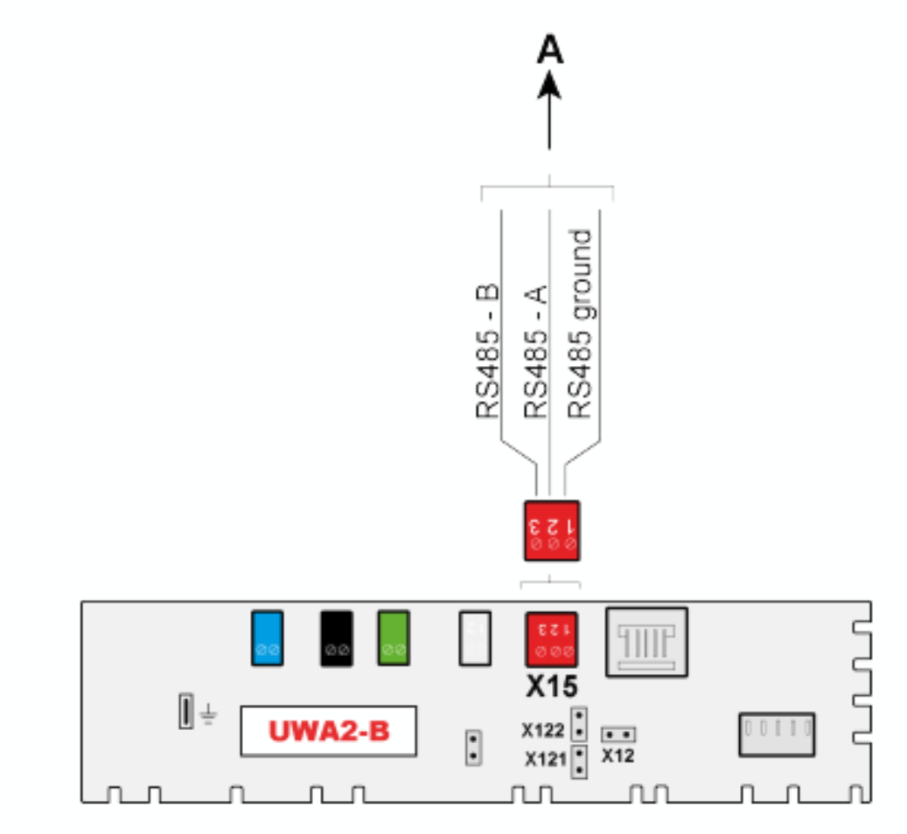

import HRUIntegrationParams from '@site/src/components/HRUIntegrationParams';

# Brink Flair

Připojení rekuperačních jednotek Flair od společnosti [Brink](https://www.brinkclimatesystems.com/) k Home Assistantu pomocí aplikace LUFTaTOR.

:::tip

Podpořte prosím tento open-source projekt zakoupením rekuperační jednotky Brink Flair či příslušenství k ní na eshopu [Luftuj.cz](https://www.luftuj.cz/vyrobci/brink-climate-systems/) či udělením hvězdičky na [Github stránce projektu](https://github.com/luftuj-cz/home-assistant)

:::

## Parametry integrace

<HRUIntegrationParams interf="ModbusTCP" power="m³/h"></HRUIntegrationParams>

V přednastavených režimech, lze také konfigurovat režimu bypassu.

Jednotka dále poskytuje přívodní a odvodní teplotu a informaci o nutnosti výměny filtrů.

## Připojení jednotky

Rekuperační jednotky Brink Flair disponují rozhraním ModbusRTU, pro připojení je tedy potřeba použít [převodník ModbusRTU na ModbusTCP](/docs/modbus).

## Nastavení v aplikaci LUFTaTOR

- Zvolte typ jednotky `Brink`
- Zadejte IP adresu jednotky a port 502
- ID jednotky (výchozí hodnota je 20)
