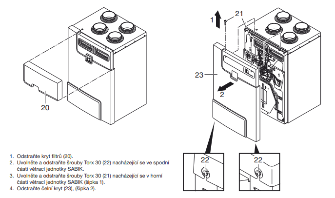
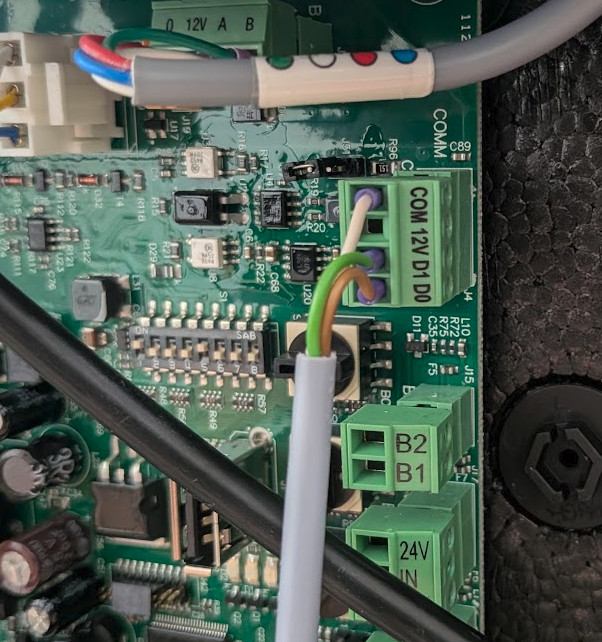

import HRUIntegrationParams from '@site/src/components/HRUIntegrationParams';

# Elektrodesign S&P Sabik

Připojení rekuperačních jednotek Sabik od společnosti [Elektrodesign](https://www.elektrodesign.cz/) (Soler & Palau) k Home Assistantu pomocí aplikace LUFTaTOR.

:::tip

Podpořte prosím tento open-source projekt zakoupením rekuperační jednotky Elektrodesign S&P Sabik či příslušenství k ní na eshopu [Luftuj.cz](https://www.luftuj.cz/vyrobci/elektrodesign/) či udělením hvězdičky na [Github stránce projektu](https://github.com/luftuj-cz/home-assistant)

:::

Rozsah nominálního průtoku u jednotlivých modelů:

| Model      | Min [m³/h] | Max [m³/h] |
| ---------- | ---------- | ---------- |
| Sabik 210  | 98         | 155        |
| Sabik 350  | 140        | 260        |
| Sabik 500  | 210        | 390        |
| Sabik 600  | 310        | 460        |  

K jednotce doporučujeme dokoupit modul SABIK-NEMBUS-SF (Servoflow), který zajistí chování jednotky v režimu Constant Flow.

## Parametry integrace

<HRUIntegrationParams interf="ModbusTCP" power="m³/h" mode="boost, automatický / manuální bypass, pozastavení větrání"></HRUIntegrationParams>

Ovládat lze také ruční bypass a povolení automatického bypassu.

Jednotka dále poskytuje:

- teploty a relativní vlhkosti vnitřního, odpadního, venkovního a přívodního vzduchu
- přívodní a odtahový průtok v m³/h
- aktuální režim jednotky (útlum, vlhkostní ochrana, snížený, nominální, boost, automatické režimy, týdenní programy)
- polohu bypassu
- počet dní do výměny filtrů a alarm zanesení filtrů
- chybový stav a poslední alarm

## Připojení jednotky

Jednotka komunikuje pomocí protokolu Modbus RTU, pro připojení potřebujete [převodník Modbus RTU na Modbus TCP](/docs/modbus).

Odstraňte přední kryt jednotky podle instrukcí v manuálu.

Připojte převodník ke svorkovnici modbusu, která se nachází v pravé horní části řídící desky.

Zapojení převodníku je následující:
- D0 -> 485B
- D1 -> 485A
- COM -> GND

Výchozí nastavení RS485 u jednotky Sabik je:
- Baudrate: 19200
- Parity: Even
- Stop bits: 1

## Nastavení v aplikaci LUFTaTOR

- Zvolte typ jednotky `Elektrodesign S&P Sabik`
- Zadejte IP adresu převodníku a port 502
- ID jednotky může být změněno pomocí modbus registru 40001, výchozí hodnota je 1.
