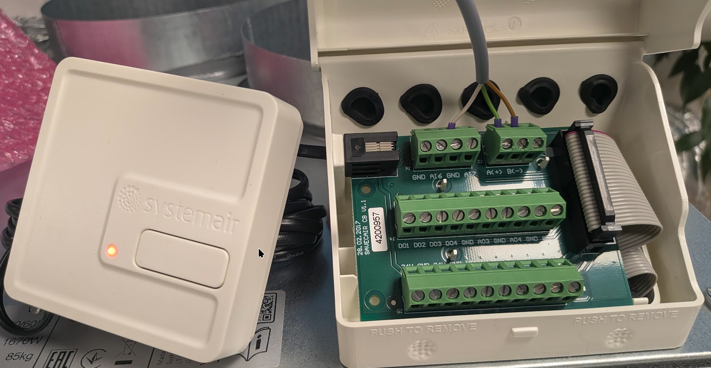
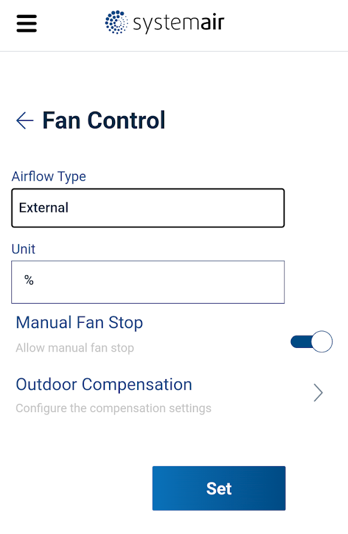
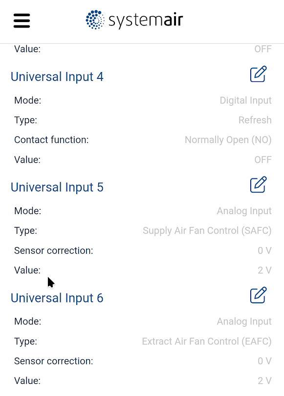

import HRUIntegrationParams from '@site/src/components/HRUIntegrationParams';

# Systemair SAVE

Připojení rekuperačních jednotek řady SAVE od společnosti [Systemair](https://www.systemair.com/) k Home Assistantu pomocí aplikace LUFTaTOR.

:::tip

Podpořte prosím tento open-source projekt zakoupením rekuperační jednotky Systemair SAVE či příslušenství k ní na eshopu [Luftuj.cz](https://www.luftuj.cz/vyrobci/systemair-a-s/) či udělením hvězdičky na [Github stránce projektu](https://github.com/luftuj-cz/home-assistant)

:::

## Parametry integrace

<HRUIntegrationParams interf="ModbusTCP" power="0-100%" temperature="12 - 30 °C"></HRUIntegrationParams>

Jednotka dále poskytuje vnitřní, venkovní a přívodní teplotu, vnitřní relativní vlhkost, počet dní do výměny filtrů a chybový stav.

## Připojení jednotky

Rekuperační jednotky Systemair disponují rozhraním ModbusRTU, pro připojení je tedy potřeba použít [převodník ModbusRTU na ModbusTCP](/docs/modbus).

- Pro připojení použijte pravou horní svorkovnici, zapojte signály A,B a GND.

Výchozí nastavení RS485 u jednotky Systemair je:
- Baudrate: 115200
- Parity: None
- Stop bits: 1

:::note[Upozornění]
Pro ovládání zařízení z HomeAssistantu není Save Connect nutný, je však nutný pro konfiguraci zařízení. Samotný Save Connect neposkytuje rozhraní Modbus TCP.
:::

- Pro konfiguraci připojte do konekturu na levé straně Save Connect a opakovaným stiskem tlačítka ho uveďte do AP režimu. Připojte se na Wifi **SystemAir** s heslem které je uvedené na zadní straně zařízení.
- V prohlížeči si otevřete [http://192.168.4.1](http://192.168.4.1).
- V menu zvolte Configuration | Communication | Modbus - odškrtněte `MB termination` a v menu Modbus zkontrolujte správné nastavení komunikace. Doporučená hodnota je baudrate 19200 bitů, 1 stop bit, parita žádná - stejné nastavení musíte mít i v převodníku Modbusu.
- V menu zvolte Configuration | Control regulation | Fan control a zvolte Airflow Type: External

- V menu zvolte Configuration | Input | Universal input
  - Vyberte libovolný volný vstup a zvolte: Analog Input - Supply Air Fan Control (SAFC) 
  - Vyberte libovolný volný vstup a zvolte: Analog Input - Extract Air Fan Control (EAFC) 

## Nastavení v aplikaci LUFTaTOR

- Zvolte typ jednotky `Systemair SAVE`
- Zadejte IP adresu jednotky (případně převodníku) a port 502
- ID jednotky může být nastaveno přes Save Connect v Configuration | Communication | Modbus, výchozí hodnota je 1.
